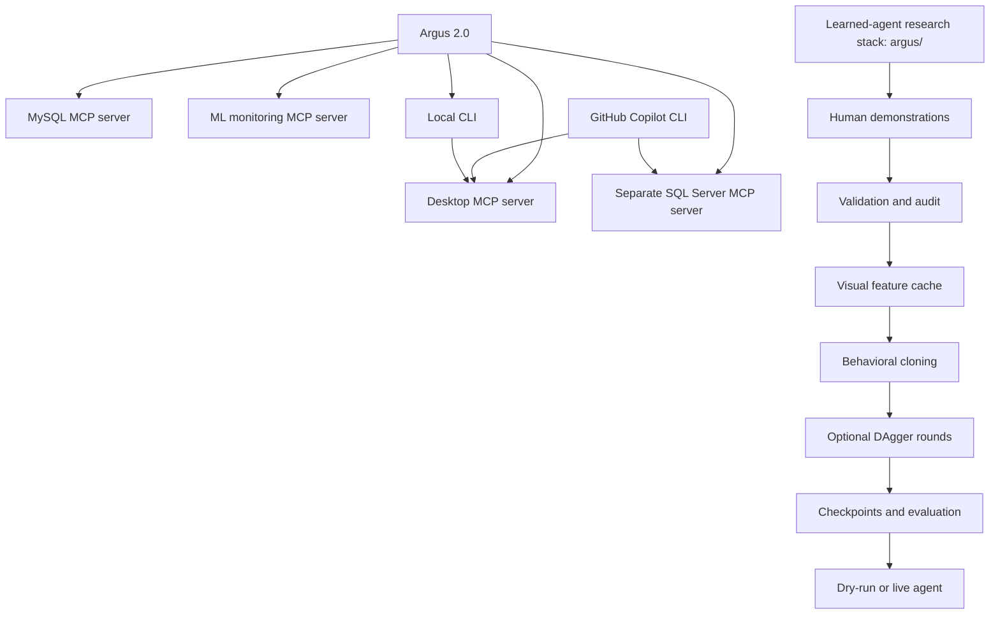

<div align="center">

# ARGUS 2.0

### Windows automation · MCP servers · Vision-based desktop-agent research

[](https://www.python.org/)
[](https://www.microsoft.com/windows)
[](https://modelcontextprotocol.io/)
[](https://pytorch.org/)
[](#project-status)

**Give your tools a bridge to Windows. Give your experiments a way to learn.**

[Quick start](#quick-start) · [Choose a workflow](#choose-your-workflow) · [Architecture](#architecture) · [Learned agent](#learned-agent-research-workflow) · [Safety](#safety-and-operational-notes)

</div>

**A Windows automation and learned desktop-agent research project, with Model Context Protocol (MCP) integrations.**

Argus brings together Windows desktop and browser tools, local command-line workflows, database MCP servers, and an experimental vision-based agent trained from demonstrations.

> **Scope:** Argus is not an unrestricted general-purpose autonomous agent. The learned-agent planner currently supports a defined set of application, calculator, and Paint tasks. The MCP desktop server exposes a broader set of system and automation tools; individual tools have their own platform, dependency, network, and permission requirements.

<details>
<summary><strong>📚 Jump to a section</strong></summary>

- [What is in this repository?](#what-is-in-this-repository)
- [Choose your workflow](#choose-your-workflow)
- [Architecture](#architecture)
- [Platform and prerequisites](#platform-and-prerequisites)
- [Quick start](#quick-start)
- [Installation](#installation)
- [Running Argus](#running-argus)
- [Learned-agent research workflow](#learned-agent-research-workflow)
- [Safety and operational notes](#safety-and-operational-notes)
- [Tests](#tests)
- [Repository layout](#repository-layout)
- [Documentation](#documentation)

</details>

## What is in this repository?

- **Desktop MCP server** — Windows system information and desktop, application, browser, file, network, and device automation tools.
- **Database MCP servers** — a separate MySQL server and a separate SQL Server server.
- **ML monitoring MCP server** — tools for inspecting the project's data-collection and training environment.
- **Local CLI** — explicit local commands and a direct MCP client; it does not require an AI model.
- **Copilot CLI integration** — a launcher and project instructions for using Argus tools through GitHub Copilot CLI.
- **Learned-agent research stack** — screenshot perception, demonstration recording, action labels, behavioral cloning, DAgger data collection, and evaluation.

## Choose your workflow

Not sure where to start? Pick the path that matches what you want to do.

| I want to… | Use this | Needs an AI model? |
|---|---|---:|
| Connect an MCP client to Windows tools | Desktop MCP server | Client-dependent |
| Run explicit local commands | Local CLI | No |
| Ask Copilot to use the registered Argus tools | Copilot CLI launcher | Yes |
| Inspect or query SQL Server | SQL Server MCP server | Client-dependent |
| Work with MySQL administration tools | MySQL MCP server | Client-dependent |
| Record demonstrations and train the visual policy | Learned-agent workflow | No external chat model; PyTorch/model weights required |

<details>
<summary><strong>⚡ Quick start: local commands (no Copilot required)</strong></summary>

Run these from PowerShell in the repository root after installing the full requirements and creating `.venv`: 

```powershell
.\start_argus_local.bat --help
.\start_argus_local.bat info
.\start_argus_local.bat health
.\start_argus_local.bat open notepad
.\start_argus_local.bat list downloads
```

The local CLI uses explicit commands. It does not translate plain English into actions.

</details>

<details>
<summary><strong>🧩 Quick start: connect an MCP client</strong></summary>

The default server is the desktop MCP server: 

```powershell
python argus_server.py --server desktop
```

Configure your MCP client to launch that command over stdio. The server process itself is not a chat UI. See the [MCP terminal guide](docs/MCP_TERMINAL.md) for client setup.

</details>

## Architecture



The three servers selected by `argus_server.py` are distinct MCP tool groups. The default is `desktop`; selecting `mysql` or `ml` starts the corresponding server instead. SQL Server is implemented separately in `argus_sqlserver.py`.

## Platform and prerequisites

The project targets **Windows**. Local desktop automation and many MCP tools use Windows applications and APIs.

- Python **3.10 or newer** (`pyproject.toml` declares `requires-python = ">=3.10"`).
- Git.
- A Windows desktop session for interactive desktop automation.
- Microsoft ODBC Driver 17 or 18 for SQL Server, only when using the SQL Server MCP server.
- A reachable MySQL instance and suitable credentials, only when using the MySQL MCP server.
- GitHub Copilot CLI, an authenticated Copilot account, and internet access, only for the Copilot workflow.
- PyTorch and the learned-agent dependencies for model training and inference. The first real DINOv2 feature-cache run downloads the configured model weights.

Feature availability depends on installed packages, local configuration, database permissions, and the Windows machine.

## Installation

Open PowerShell in the repository directory.

### 1. Clone the repository and create a virtual environment

```powershell
git clone https://github.com/Saurav021406/argus2.o.git
cd argus2.o

py -3.10 -m venv .venv
.\.venv\Scripts\Activate.ps1
python -m pip install --upgrade pip
```

If PowerShell blocks activation, call `.venv\Scripts\python.exe` directly instead.

### 2. Install dependencies

For the complete server and project dependency set:

```powershell
python -m pip install -r requirements.txt
```

This is the appropriate baseline for starting `argus_server.py`. Although the default `desktop` mode does not open a MySQL connection, `argus_server.py` currently imports the MySQL connector at module import time, so the connector package is still required to start that script.

For the smaller demonstration and action pipeline, the repository also provides:

```powershell
python -m pip install -r requirements-core.txt
```

For behavioral-cloning training, install `requirements-bc.txt` on top of an environment where PyTorch is already installed:

```powershell
python -m pip install -r requirements-bc.txt
```

These are different dependency profiles, not interchangeable lockfiles. `requirements-core.txt` does not install the MCP server's complete dependencies. `requirements-bc.txt` does not pin or install PyTorch; install a PyTorch build appropriate for the machine and CPU/GPU setup first.

## Running Argus

### Desktop MCP server (default)

```powershell
python argus_server.py
```

This starts the desktop MCP server over stdio. An MCP-compatible client normally launches the process and communicates with it; running it in a terminal does not itself provide a chat interface.

The server can be selected explicitly:

```powershell
python argus_server.py --server desktop
python argus_server.py --server mysql
python argus_server.py --server ml
```

The desktop server is the default and does not establish a MySQL connection. The MySQL mode is separate and needs a configured, reachable MySQL instance.

<details>
<summary><strong>MySQL MCP server (optional)</strong></summary>


The MySQL mode reads these environment variables: `MYSQL_HOST`, `MYSQL_PORT`, `MYSQL_USER`, `MYSQL_PASSWORD`, and `MYSQL_DATABASE`.

```powershell
$env:MYSQL_HOST = "localhost"
$env:MYSQL_PORT = "3306"
$env:MYSQL_USER = "your-user"
$env:MYSQL_PASSWORD = "your-password"
$env:MYSQL_DATABASE = "your-database"
python argus_server.py --server mysql
```

Use a dedicated MySQL account with only the permissions needed for the intended tasks. The MySQL server includes database administration and write-capable tools; do not treat it as a read-only server. Do not commit real credentials.

</details>

### ML monitoring MCP server

```powershell
python argus_server.py --server ml
```

This is a monitoring/integration tool group for the project's ML environment. It is distinct from the learned policy in the `argus/` package.

<details>
<summary><strong>SQL Server MCP server (optional, separate process)</strong></summary>


```powershell
python argus_sqlserver.py
```

By default, the server uses Windows Integrated Authentication with instance `.\SQLEXPRESS` and database `MyDatabase`. Override these defaults with environment variables:

```powershell
$env:ARGUS_SQLSERVER_INSTANCE = ".\SQLEXPRESS"
$env:ARGUS_SQLSERVER_DATABASE = "MyDatabase"
python argus_sqlserver.py
```

The server exposes five tools for connection, database, table, and schema inspection plus `execute_read_query`. That query tool accepts one statement beginning with `SELECT`, rejects semicolons, SQL comments, and a list of write/administrative keywords, uses a 15-second query timeout, and returns at most 200 rows. These checks are application-level validation, not a substitute for giving the Windows account a least-privilege SQL Server login.

</details>

### Local CLI (no AI model required)

The Windows launcher uses the repository's `.venv`:

```powershell
.\start_argus_local.bat --help
.\start_argus_local.bat info
.\start_argus_local.bat health
.\start_argus_local.bat open notepad
.\start_argus_local.bat open calculator
.\start_argus_local.bat open downloads
.\start_argus_local.bat list downloads
```

The CLI accepts explicit commands, not arbitrary natural-language instructions. It can show system information and health, open supported applications and folders or an exact non-executable file path, list a directory, and delete one exact file after the user types `DELETE`. It refuses executable and script targets through `open`; deletion rejects directories and symbolic links.

The local CLI can also act as an MCP client. In PowerShell, use the `.ps1` launcher:

```powershell
& .\start_argus_local.ps1 mcp list
& .\start_argus_local.ps1 mcp list --filter system
& .\start_argus_local.ps1 mcp call get_system_info
& .\start_argus_local.ps1 mcp call open_app_with_url --args '{"app_name":"notepad"}'
```

Before a direct MCP call, the CLI displays the tool name and arguments and requires typing `CALL`. Review the requested operation before confirming it. Some server tools can change files or Windows settings.

### GitHub Copilot CLI integration

```powershell
.\start_argus_copilot.bat
```

This launcher starts the installed Copilot CLI with its `auto` model, loads the repository's `.github/instructions`, and uses the user's existing Copilot MCP registration. Copilot CLI must already be installed, signed in, and online. The launcher does not install Copilot or create the MCP registration.

The checked-in project instructions document a current user-level allowlist of five Argus tools: `get_system_info`, `system_uptime`, `system_health_check`, `open_app_with_url`, and `run_command`. This is not the full desktop MCP tool set. The local MCP client can discover and call tools exposed by the local desktop server.

For the terminal workflow, MCP configuration, and troubleshooting, see [MCP terminal guide](docs/MCP_TERMINAL.md).

## Learned-agent research workflow

The `argus/` package contains a separate vision-and-action learning pipeline. It is experimental and is not required for the desktop MCP server or local CLI.

### Current design and supported scope

- **Task planning:** `argus/core/planner.py` converts supported instructions into explicit sub-goals. Current supported patterns include opening Notepad, Calculator, or Paint; calculator button sequences; and drawing a line or a three-stroke zigzag in Paint.
- **Action representation:** `argus/actions/action_space.py` defines seven action types: `MOVE`, `CLICK`, `DRAG`, `TYPE`, `KEY`, `SCROLL`, and `DONE`. Screen locations use a 32 × 32 discrete grid.
- **Perception:** `argus/perception/vision_encoder.py` uses a frozen DINOv2-small encoder and retains spatial patch features. A deterministic random encoder is available for tests.
- **Data collection:** `argus/data/` records demonstrations, stores frames and action labels, and provides validation, audit, coverage, overlay, replay, and statistics commands.
- **Policy:** `argus/policy/policy.py` implements a causal temporal-transformer policy with action and location heads.
- **Training:** `argus/training/` caches visual features and trains the policy with behavioral cloning.
- **Iteration and evaluation:** `argus/core/` includes the live agent, DAgger rollout workflow, task suite, held-out prompts, trace explanations, and checkpoint comparisons.

The planner is deliberately constrained to known task templates. A familiar-sounding request outside those templates, or a task requiring a button/goal absent from the checkpoint's demonstrations, can be rejected. This is not general-purpose autonomous desktop understanding.

### Record and inspect demonstrations

Discover the available commands:

```powershell
python -m argus.data --help
```

Start a guided recording session or record one explicit task:

```powershell
python -m argus.data session --plan first
python -m argus.data record --instruction "Open Notepad" --task open_app --app notepad
```

A recording starts after a countdown; press `F10` to stop. Review and validate the saved episode before using it for training. The session plans include specific calculator demonstration batches; use `python -m argus.data session --help` to see the available plan names.

Inspect an individual episode and the dataset:

```powershell
python -m argus.data validate datasets/raw/<episode>
python -m argus.data overlay datasets/raw/<episode>
python -m argus.data replay datasets/raw/<episode> --dry-run
python -m argus.data audit
python -m argus.data coverage
python -m argus.data stats
```

Omit `--dry-run` from `replay` only when you deliberately intend to replay the recorded actions on the live desktop.

### Cache visual features and train

```powershell
python -m argus.training cache --root datasets/raw --out datasets/features
python -m argus.training train --features datasets/features --out checkpoints/bc_v1.pt
```

The real feature-cache command loads DINOv2-small; its first run downloads the configured model weights. For a pipeline smoke test that does not download DINOv2 weights:

```powershell
python -m argus.training cache --root datasets/raw --out datasets/features_test --fake
```

The fake encoder is for pipeline tests, not for producing a useful trained vision model.

### Run and evaluate a checkpoint

```powershell
python -m argus.core --help
python -m argus.core run --ckpt checkpoints/bc_v1.pt --instruction "Open Notepad" --dry-run
python -m argus.core suite --ckpt checkpoints/bc_v1.pt --levels 1,2
python -m argus.core summary
```

The live agent follows an observe → predict → act → wait → observe loop. A checkpoint can only use goals represented in its training data. The planner may reject an instruction that requires an untrained button or goal.

The core CLI also provides `dagger`, `explain`, `compare`, and `inkcheck`; discover their exact arguments with `python -m argus.core <command> --help`.

## Safety and operational notes

- **Live desktop control changes your real Windows session.** Close unrelated work and keep your hands off the mouse and keyboard while an agent run is active.
- The action executor enables PyAutoGUI's failsafe and configures all four screen corners as abort points when supported. Move the mouse to a corner to trigger the failsafe.
- Use `--dry-run` for a prediction pass that does not execute mouse or keyboard actions.
- The learned-agent safety validator blocks a limited set of key combinations and checks action bounds. It is a guardrail, not a security boundary. The screen-capture and input helpers make the process DPI-aware on Windows where supported, but display scaling and window layout can still affect recorded coordinates.
- Direct local MCP calls require typing `CALL`, and local file deletion requires typing `DELETE`. These confirmations reduce accidental actions; they do not make every server tool harmless.
- The MySQL server includes write-capable database tools. Use least-privilege database credentials and inspect each requested operation.
- SQL Server query filtering is not a replacement for database permissions.
- Never commit database passwords, tokens, personal data, screenshots, raw demonstrations, feature caches, model checkpoints, or run outputs. The repository's `.gitignore` excludes several local data/output directories and environment files; review new paths before committing.

## Tests

The repository includes automated tests for MCP server groups, SQL Server MCP behavior, the local CLI, the planner, action execution, data validation and auditing, behavioral cloning, DAgger, and evaluation.

Run the test suite from the repository root in an environment with the test dependencies installed:

```powershell
python -m pytest -q
```

Some tests use optional dependencies or Windows-specific behavior. A passing unit-test suite is not equivalent to validating live automation on every Windows configuration.

## Repository layout

```text
argus2.o/
├── argus_server.py              # Desktop, MySQL, and ML MCP servers
├── argus_sqlserver.py           # Separate SQL Server MCP server
├── argus_office.py              # Office integration module
├── argus/
│   ├── actions/                 # Action types, coordinate mapping, executor
│   ├── core/                    # Planner, agent, DAgger, evaluation tools
│   ├── data/                    # Recording, validation, audit, replay
│   ├── language/                # Instruction encoders
│   ├── local_cli.py             # Explicit local commands and MCP client
│   ├── perception/              # Screen capture and visual encoders
│   ├── policy/                  # Learned action policy
│   ├── safety/                  # Action-validation guardrails
│   └── training/                # Feature caching and behavioral cloning
├── docs/                        # Feature and setup guides
├── examples/                    # Example launcher helpers
├── tests/                       # Automated tests
├── requirements*.txt            # Dependency profiles
├── pyproject.toml               # Package metadata and CLI entry points
└── start_argus_*.bat/.ps1       # Windows launchers
```

## Documentation

- **[MCP terminal and Copilot CLI guide](docs/MCP_TERMINAL.md)** — current setup and command reference.
- **[Learned-agent guide](README_CORE.md)** — demonstration, training, and evaluation workflow.

<details>
<summary><strong>📖 Historical and feature-specific documentation</strong></summary>

- [MCP GUI documentation](docs/MCP_GUI_DOCUMENTATION.md) — historical guide; some referenced files are not in the current repository tree.
- [Advanced automation documentation](docs/ADVANCED_AUTOMATION_DOCUMENTATION.md) — historical feature notes; verify commands against the current server before relying on them.
- [Advanced PC control notes](docs/ADVANCED_PC_CONTROL_COMPLETE.md) — historical feature notes; verify commands against the current server before relying on them.
- [Lightroom MCP command reference](docs/LIGHTROOM_MCP_COMMANDS.md) — verify individual tool names against the current server's MCP listing.
- [Natural-language guide](docs/NATURAL_LANGUAGE_GUIDE.md) — historical examples, not a guarantee that the described commands are available in every client configuration.

</details>

## Project status

This repository combines a broad legacy MCP desktop-automation server with a newer, modular learned-agent research pipeline. Live behavior depends on Windows, local configuration, installed dependencies, database connectivity, client-side MCP allowlists, and the learned checkpoint/data available on the machine.

Contributions and issue reports are welcome. Include the operating system, Python version, server mode, command, and sanitized error output when reporting a problem.
